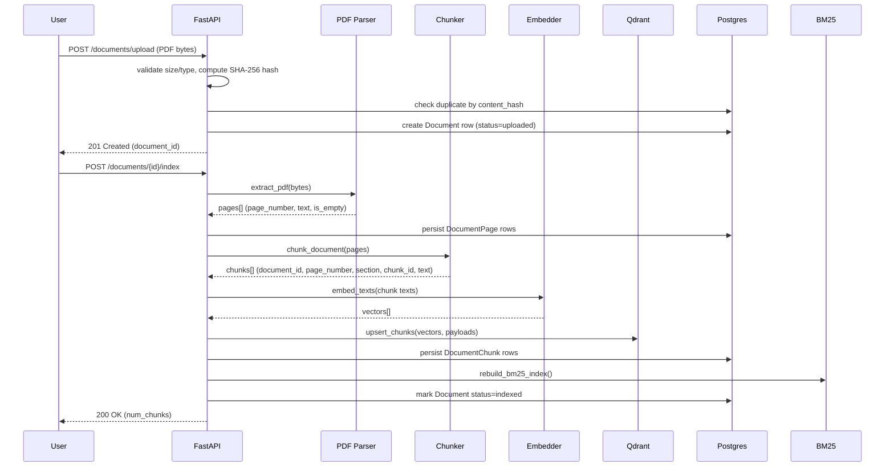

# Architecture

## System overview

```mermaid
flowchart TD
    U[User] --> FE[Frontend - Next.js Dashboard]
    FE -->|REST/JSON| API[FastAPI Backend]

    subgraph Ingestion Pipeline
        API --> UP[Upload Endpoint]
        UP --> PARSE[PDF Parser - PyMuPDF]
        PARSE --> CHUNK[Chunker - configurable size/overlap]
        CHUNK --> EMB[Embedder - Sentence Transformers]
        EMB --> VDB[(Qdrant Vector DB)]
        CHUNK --> BM25IDX[BM25 Index - in-memory]
        CHUNK --> PG[(PostgreSQL - chunks/pages/metadata)]
    end

    subgraph Query Pipeline
        API --> Q[Query Endpoint]
        Q --> QEMB[Embed Question]
        QEMB --> VS[Vector Search - top_k]
        Q --> BM[BM25 Search - top_k]
        VS --> FUSE[Hybrid Fusion - RRF]
        BM --> FUSE
        FUSE --> RR[Cross-Encoder Reranker]
        RR --> CTX[Context Builder]
        CTX --> LLM[LLM - Anthropic/OpenAI]
        LLM --> ANS[Answer + Citations]
        ANS --> API
    end

    subgraph Evaluation
        EVAL[scripts/evaluate.py] --> Q
        EVAL --> METRICS[Recall@K / MRR / Hit Rate / Latency]
    end

    VDB --> VS
    BM25IDX --> BM
    PG --> CTX
```

## Ingestion pipeline (detail)



## Why Qdrant over pgvector

Both are valid, defensible choices for this project's vector store, and the
`VectorStore` interface (`app/retrieval/vector_store.py`) is small enough
that swapping the backing implementation is a single-file change. We chose
**Qdrant** for the reference implementation because:

- It's a purpose-built vector database: native payload filtering
  (`document_id`, `page_number`) alongside HNSW approximate-nearest-neighbor
  search, without needing to hand-roll SQL + a vector extension.
- Vectors and their metadata payload live together, so a filtered search
  ("only search chunks from these 3 documents") is one API call.
- It demonstrates a very common production RAG pattern and is a frequent
  interview topic ("why not just use Postgres for everything?" -- see
  docs/interview_questions.md).

pgvector is the right call when you want to minimize infrastructure (one
database instead of two) and your team is already deeply invested in
Postgres operational tooling (backups, replication, monitoring). At the
scale this project targets (a handful to a few hundred documents), either
choice performs well; the trade-off becomes more relevant at very large
scale, discussed in docs/deployment.md and interview_questions.md ("how
would you handle 1 million documents?").

## Why hybrid retrieval + reranking, not just vector search

See `docs/ml_concepts.md` for the full explanation of each concept. In one
sentence: vector search alone can miss exact terms (ticker symbols, exact
figures) that BM25 always catches, and BM25 alone can miss paraphrased
questions that vector search always catches -- fusing both with Reciprocal
Rank Fusion and then reranking the fused candidate set with a cross-encoder
gets the precision benefits of both stages without the cost of running a
cross-encoder over the entire corpus.

## Data model

See `backend/app/models/models.py` for the full SQLAlchemy schema:
`documents`, `document_pages`, `document_chunks`, `queries`,
`retrieval_results`, `evaluations` -- all with UUID primary keys,
timestamps, foreign keys with cascade deletes, and indexes on the columns
used for filtering (`status`, `document_id`, `page_number`, `query_id`).
